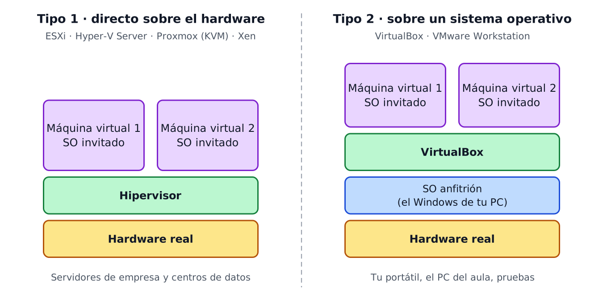
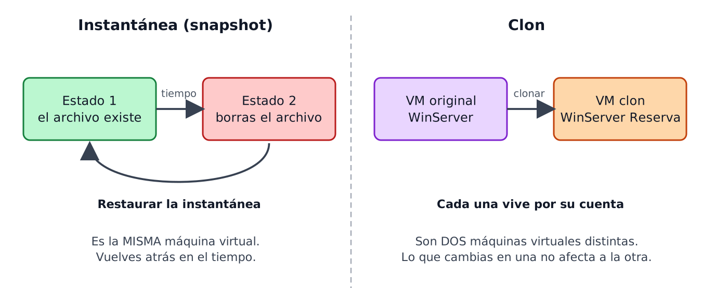
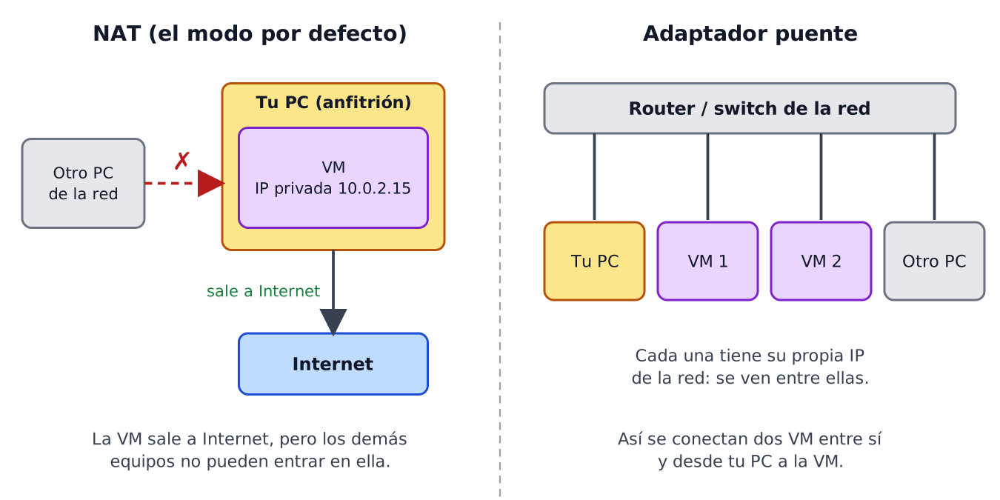
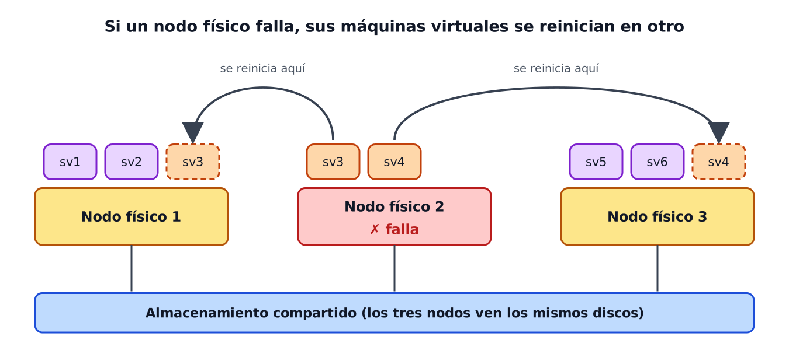

# Tema 4 — Máquinas virtuales

---

## Índice

1. [Introducción](#1-introducción)
2. [Virtualización de sistemas](#2-virtualización-de-sistemas)
3. [Tipos de virtualización](#3-tipos-de-virtualización)
4. [Herramientas de virtualización](#4-herramientas-de-virtualización)
5. [Configuración y uso de máquinas virtuales](#5-configuración-y-uso-de-máquinas-virtuales)
6. [Alta disponibilidad y virtualización](#6-alta-disponibilidad-y-virtualización)
7. [Simulación de servicios](#7-simulación-de-servicios)
8. [Pruebas de carga](#8-pruebas-de-carga)

---

## 1. Introducción

Virtualizar es ejecutar varios sistemas operativos en **un solo ordenador físico**, cada uno dentro de su máquina virtual (VM). Un programa llamado **hipervisor** reparte entre ellas la CPU, la RAM, el disco y la red.

En el Tema 3 ya viste qué es una VM (host, guest, hipervisor). Aquí vemos **para qué sirve, qué tipos hay y qué herramientas existen**, y sobre todo cómo **manejar VirtualBox a fondo**: Guest Additions, carpetas compartidas, clones, instantáneas y discos adicionales. Cada apartado importante termina en un bloque **"Pruébalo"**, y todo se junta en la [práctica de VirtualBox](practica-virtualbox.md).

## 2. Virtualización de sistemas

| Ventajas | Por qué |
|---|---|
| Reutilizar hardware | Un equipo sirve para probar muchos sistemas |
| Ahorrar dinero | Menos servidores que comprar, y menos espacio y consumo eléctrico (*Green IT*) |
| Administración centralizada | Se gestionan muchas máquinas desde un único sitio |
| Clonar y copiar con facilidad | Duplicar un servidor es copiar un archivo |
| Menos tiempo parado (*downtime*) | Si algo falla, se restaura o se mueve la VM |

| Desventajas | Por qué |
|---|---|
| Hace falta un equipo potente | RAM, disco y red se reparten, así que el equipo real va más lento |
| Requiere más conocimientos | Hay que configurar y administrar el software de virtualización |

**Pruébalo:** comprueba si tu equipo permite virtualizar.
1. Abre el Administrador de tareas (`Ctrl + Mayús + Esc`) → pestaña **Rendimiento** → **CPU**.
2. Abajo a la derecha busca **Virtualización: Habilitada**. Si pone *Deshabilitada*, hay que activarla en la BIOS.
3. En `cmd`, ejecuta `systeminfo` y mira el final: *Requisitos de Hyper-V*.

## 3. Tipos de virtualización

Existen ocho tipos, según **qué recurso** se virtualiza:

| Tipo | Qué hace | Ejemplo |
|---|---|---|
| Hardware o servidor | Varios servidores virtuales sobre un servidor físico potente | ESXi, Proxmox |
| Sistema operativo | Máquinas virtuales sobre un SO normal | VirtualBox en tu Windows |
| Escritorio (VDI) | Acceder al escritorio de la empresa desde cualquier dispositivo | Citrix, Azure Virtual Desktop |
| Red | Redes con tarjetas y *switches* virtuales, sin cableado físico extra | Switch virtual, VLAN |
| Almacenamiento | Varios discos que se ven como uno solo | RAID, SAN |
| Memoria | Reparte la RAM de forma dinámica entre las VM | Memoria dinámica de Hyper-V |
| Gráfica | Usar una GPU potente de forma remota | Diseño 3D desde la nube |
| Aplicaciones | Ejecutar programas sin instalarlos en tu equipo | Aplicaciones remotas de Citrix |

Los dos primeros son los que más vas a ver, y se distinguen por **dónde se instala el hipervisor**:

| | Tipo 1 (hardware) | Tipo 2 (sistema operativo) |
|---|---|---|
| Se instala | Directamente sobre el hardware | Como un programa más dentro de Windows o Linux |
| Uso típico | Servidores de empresa, centros de datos | Portátiles, aulas, pruebas |
| Ejemplos | ESXi, Hyper-V Server, Proxmox (KVM), Xen | **VirtualBox**, VMware Workstation |

> En clase usamos **VirtualBox, que es de tipo 2**: se instala como un programa más sobre el Windows del aula.

## 4. Herramientas de virtualización

Hay de pago y gratuitas. Lo importante es elegir la que **sea compatible con el software que vas a usar** y se adapte al negocio.

| | Herramienta | Qué es |
|---|---|---|
| Propietaria | **VMware** | La empresa líder del sector: ESXi/vSphere para servidores y Workstation para el escritorio |
| Propietaria | **Microsoft Hyper-V** | Viene incluido en Windows Pro, Enterprise y Education (no en Home) y en Windows Server |
| Propietaria | **Citrix** | Escritorios y aplicaciones virtuales, y también redes |
| Libre | **VirtualBox** | De Oracle. Gratuito, multiplataforma (Windows, Linux, Mac) y muy usado en formación |
| Libre | **QEMU / KVM** | KVM convierte el núcleo de Linux en hipervisor. QEMU emula arquitecturas (32 y 64 bits) |
| Libre | **Xen** | Hipervisor que corre en el nivel más privilegiado de la máquina |
| Libre | **Proxmox VE** | Plataforma de servidores basada en KVM, con interfaz web |

> Las condiciones de licencia de VMware han cambiado varias veces (el libro habla de *Workstation Player*, que ya no existe: hoy lo sustituye *Workstation Pro*, gratuito). Comprueba siempre la web del fabricante antes de usarlo en una empresa.

## 5. Configuración y uso de máquinas virtuales

### 5.1. Antes de crear la máquina

Tres pasos antes de instalar nada:

| Paso | Pregunta que te haces |
|---|---|
| 1. Tener claros los objetivos | ¿Virtualizo un servidor o un escritorio? No es lo mismo |
| 2. Analizar los productos | ¿Qué hay de pago y qué es libre? |
| 3. Comprobar el hardware | ¿Mi equipo tiene CPU y RAM suficientes, y la virtualización activada? |

### 5.2. VirtualBox: lo que vas a tocar

Ya sabes crear una VM (Tema 3): nombre, SO, RAM, CPU, disco y red. Ahora, las funciones que la hacen útil:

| Función | Para qué sirve | Dónde se activa |
|---|---|---|
| **Guest Additions** | Mejoran la VM: pantalla, ratón, portapapeles y carpetas compartidas | VM encendida → *Dispositivos* → *Insertar imagen de CD de las Guest Additions* |
| Portapapeles y arrastrar y soltar | Copiar, pegar y mover archivos entre tu PC y la VM | *Configuración* → *General* → *Avanzado* → **Bidireccional** (necesita las Guest Additions) |
| Carpetas compartidas | Una carpeta de tu PC visible dentro de la VM | *Configuración* → *Carpetas compartidas* |
| Instantánea | Foto del estado de la VM para poder volver atrás | *Herramientas* → *Instantáneas* |
| Clon | Copia independiente de una VM | *Máquina* → *Clonar* |
| Disco adicional | Más almacenamiento para la VM | *Configuración* → *Almacenamiento* |
| Red | NAT o adaptador puente | *Configuración* → *Red* |

> Los nombres de los menús pueden variar un poco según la versión de VirtualBox.

**Instantánea o clon, que se confunden:**

| | Instantánea | Clon |
|---|---|---|
| Qué es | Una foto de la VM en un momento | Una copia completa e independiente |
| Resultado | La misma VM | Una VM nueva |
| Para qué | Probar algo y poder deshacerlo | Tener una copia de reserva o varias VM iguales |
| Espacio | Poco: solo guarda los cambios | Mucho: otro disco, tanto como use la VM |
| Si borras la original | La instantánea desaparece con ella | El clon sigue funcionando |

> **Clon completo o enlazado.** El completo copia todo el disco (independiente, pero ocupa mucho). El enlazado comparte el disco con la original: ocupa muy poco, pero depende de ella.

**Red, la parte que más confunde:**

**Los discos virtuales:**

| Archivo | Qué es |
|---|---|
| `.vbox` | La configuración de la VM |
| `.vdi` | El disco duro de la VM, que para tu PC es un solo archivo |
| Carpeta `Snapshots` | Los cambios guardados desde cada instantánea |

| Tipo de disco | Cómo funciona |
|---|---|
| Reservado dinámicamente | Crece según lo usas, hasta el máximo. Un disco de 50 GB puede ocupar solo 15 GB |
| Tamaño fijo | Reserva todo el espacio desde el principio. Algo más rápido |

**Pruébalo:** averigua cuánto ocupa de verdad tu VM.
1. En VirtualBox: *Archivo* → *Herramientas* → *Administrador de medios virtuales*.
2. Selecciona el disco de tu VM y mira **Tamaño virtual** y **Tamaño real**.
3. ¿Por qué el real es menor que el virtual?

### 5.3. Hyper-V (para reconocer)

La herramienta de Microsoft, incluida en Windows 10/11 Pro, Enterprise y Education. No la usamos en el aula, pero hay que reconocerla:

| Paso | Cómo |
|---|---|
| 1. Comprobar requisitos | `systeminfo` en `cmd` |
| 2. Activarla | PowerShell como administrador: `Enable-WindowsOptionalFeature -Online -FeatureName Microsoft-Hyper-V -All` |
| 3. Reiniciar | Obligatorio |
| 4. Usarla | Buscar *Administrador de Hyper-V* → *Creación rápida* |

También se maneja desde PowerShell:

| Comando | Qué hace |
|---|---|
| `Get-VM` | Lista las máquinas virtuales |
| `Start-VM -Name` | Arranca una VM |
| `Stop-VM -Name` | Apaga una VM |
| `Export-VM` | Exporta una VM |
| `Remove-VM` | Elimina una VM |
| `Rename-VM` | Cambia el nombre de una VM |

> Si en Windows está activo Hyper-V (o funciones que lo usan, como WSL 2), VirtualBox va más lento. Es lo que indica la **tortuga** en la barra de estado de VirtualBox (el problema que vimos en el Tema 3).

## 6. Alta disponibilidad y virtualización

Alta disponibilidad es que los servicios **sigan funcionando aunque algo falle**. 

| Ventaja | Qué significa |
|---|---|
| Aplicaciones siempre activas | Continuidad del negocio aunque falle el hardware |
| Reparto de carga | La carga se reparte entre servidores para que ninguno se sature |
| Aislamiento | Cada servicio en su VM: un fallo no tumba a los demás |
| Recuperación ante desastres | Copias y restauración casi automáticas |
| Escritorios protegidos | Un usuario recupera su sesión en segundos desde otro equipo |
| Flexibilidad y escalabilidad | Se amplía la RAM, CPU o disco de una VM según la demanda |

## 7. Simulación de servicios

Consiste en **imitar un servicio real dentro de un entorno virtual** para probarlo sin riesgo: configuraciones, actualizaciones o qué pasa si algo cae.

| Fase | Qué se hace |
|---|---|
| 1. Identificar errores | Se analizan los registros (*logs*) para ver qué falló y por qué |
| 2. Diseñar | Se plantea la nueva infraestructura (clústeres, equipos, conmutadores...) |
| 3. Simular | Se prueba el diseño en máquinas virtuales antes de comprarlo o montarlo de verdad |

> El hábito de un buen administrador: **antes de tocar algo importante, haz una instantánea** (o prueba en un clon). Si sale mal, vuelves atrás.

## 8. Pruebas de carga

Miden cómo responde un sistema cuando **muchos usuarios lo usan a la vez**, para saber su rendimiento antes de que falle. Se hacen con usuarios simulados (**cargas sintéticas**).

| Prueba | Qué mide |
|---|---|
| Backend y frontend | Cómo responde el servidor y cuánto tarda en verse la web en el navegador |
| Basadas en protocolos | Peticiones HTTP/HTTPS directas al servidor |
| En el navegador | El rendimiento de lo que ve el usuario |
| De componentes | Dónde se rompe un servicio concreto |
| De extremo a extremo | Un recorrido completo de usuario (entrar, buscar, comprar) |

Herramientas: **k6** (libre, de Grafana), **Apache JMeter** y, para medir hosts y VM de VMware, vSphere.

---

## Resumen del tema

| Tema | Lo que hay que saber hacer |
|---|---|
| Virtualización | Explicar qué es y citar ventajas y desventajas |
| Tipos | Reconocer los ocho tipos y distinguir hipervisor de tipo 1 y de tipo 2 |
| Herramientas | Clasificar VMware, Hyper-V y Citrix (de pago), y VirtualBox, KVM, Xen y Proxmox (libres) |
| VirtualBox | Instalar las Guest Additions, compartir carpeta, clonar, hacer instantáneas y añadir un disco |
| Instantánea y clon | Saber la diferencia: la instantánea vuelve atrás en la misma VM, el clon es otra VM |
| Red | Diferenciar NAT y puente |
| Alta disponibilidad | Los servivios siguen funcionando aunque algo falle |
| Simulación y carga | Saber para qué sirve probar antes en un entorno virtual |

