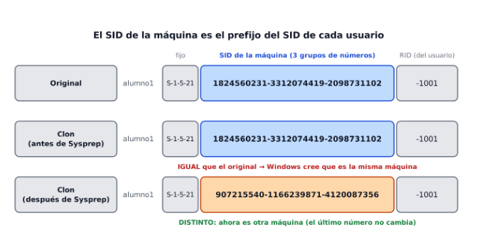

# Tema 5 — Sistemas operativos propietarios: instalación, administración y configuración

---

## Índice

1. [Introducción](#1-introducción)
2. [Antes de instalar](#2-antes-de-instalar)
3. [Automatizar instalaciones: Sysprep y el SID](#3-automatizar-instalaciones-sysprep-y-el-sid)
4. [Controladores de dispositivos](#4-controladores-de-dispositivos)
5. [Estructura de directorios](#5-estructura-de-directorios)
6. [Información del sistema](#6-información-del-sistema)
7. [Software instalado y actualizaciones](#7-software-instalado-y-actualizaciones)
8. [Línea de comandos: de WMIC a PowerShell](#8-línea-de-comandos-de-wmic-a-powershell)
9. [Rendimiento y estadísticas](#9-rendimiento-y-estadísticas)

---

## 1. Introducción

Instalar Windows es solo el principio. Después hay que **dejarlo a punto**: actualizado, con sus controladores, y saber dónde mirar para ver qué tiene instalado y cómo rinde.

| Ya sabes... | En este tema aprenderás... |
|---|---|
| Qué es un SO y cómo se clasifica (Tema 3) | Cómo se instala y cómo se prepara para instalarlo en **muchos equipos a la vez** |
| Qué es un clon de una VM (Tema 4) | Por qué un clon **no es exactamente un equipo nuevo**, y cómo se arregla (Sysprep) |
| Las herramientas gráficas de Windows | Sus equivalentes en **PowerShell** |

> Windows 10 dejó de recibir soporte general el 14 de octubre de 2025, pero lo que aprendes aquí sirve igual para Windows 11 y Windows Server.

---

## 2. Antes de instalar

### 2.1. Requisitos y versiones

Antes de instalar hay que comprobar que el equipo cumple los **requisitos de hardware** y elegir la **versión** adecuada.

| Requisito | Windows 10 (mínimo) | Windows 11 (mínimo) |
|---|---|---|
| Procesador | 1 GHz | 1 GHz, 2 núcleos, 64 bits |
| RAM | 1 GB (32 bits) / 2 GB (64 bits) | 4 GB |
| Disco | 1 GB (32 bits) / 2 GB (64 bits) | 64 GB |
| Tarjeta gráfica | DirectX 9 o superior | DirectX 12 |
| Pantalla | 800 × 600 | 720p |
| Otros | — | UEFI con Arranque seguro y **TPM 2.0** |

| Versión de Windows 10 | Para quién | Licencia |
|---|---|---|
| **Home** | Usuarios domésticos | Normalmente OEM |
| **Pro** | Profesionales y pymes: unirse a un dominio, escritorio remoto... | OEM o retail |
| **Enterprise** | Grandes empresas: VPN y restricciones de aplicaciones | Solo por volumen |
| **LTSC** | Como Enterprise, sin Cortana, Edge ni multimedia: más ligera | Por volumen |

**Pruébalo:** ¿tu VM cumpliría los requisitos?
1. Abre el **Administrador de tareas** → pestaña *Rendimiento*.
2. Mira la **CPU** y la **Memoria**, y en el Explorador el tamaño del disco **C:**.
3. Compáralos con la tabla de Windows 11.

### 2.2. Soporte y proceso de instalación

| Soporte | Cómo es |
|---|---|
| USB | Pendrive de **8 GB o más**. Es lo más habitual |
| DVD | Se graba la ISO en un disco |
| Red | El equipo arranca y descarga la instalación de un servidor |
| Virtual | Una **ISO** conectada a la VM (lo que hacemos nosotros) |

Microsoft ofrece la **Media Creation Tool**: descarga la ISO y prepara el USB. Hace falta Internet y una licencia.
[text](https://www.microsoft.com/es-es/software-download/windows11)

El proceso, paso a paso:

| Paso | Qué se hace |
|---|---|
| 1 | Guardar los datos importantes: **al instalar de cero se borra el disco** |
| 2 | Conectar el USB o la ISO |
| 3 | Entrar en la **BIOS/UEFI** (con `F2`, `F10`, `F12` o `Supr`, según el fabricante) |
| 4 | En *Boot*, poner **primero** el USB o el DVD. Si hace falta, desactivar *Secure Boot* |
| 5 | Reiniciar y seguir el asistente de instalación |

### 2.3. Ajustes después de instalar

| Ajuste | Qué se hace | Dónde |
|---|---|---|
| Actualizar Windows | Instalar todo lo pendiente | Configuración → Windows Update |
| Controladores | Comprobar que están todos | Administrador de dispositivos |
| Seguridad | Antivirus, cortafuegos, y BitLocker si procede | Seguridad de Windows |
| Sistema | Resolución, energía, notificaciones | Configuración → Sistema |
| Aplicaciones | Quitar las preinstaladas que sobran | Configuración → Aplicaciones |
| Cuentas | Crear usuarios, control parental | Configuración → Cuentas |
| Red | Redes y recursos compartidos | Configuración → Red e Internet |
| Rendimiento | Quitar programas que arrancan con Windows | Administrador de tareas → Inicio |

---

## 3. Automatizar instalaciones: Sysprep y el SID

En una empresa no se instala Windows equipo a equipo. Se prepara **un equipo modelo** y se copia en todos los demás.

### 3.1. Sysprep

**Sysprep** viene incluido en Windows, en `C:\Windows\System32\Sysprep`. Quita del equipo lo que es **propio de él** (como su identificador de seguridad) para que se pueda copiar a otros.

| Opción de Sysprep | Qué hace |
|---|---|
| Configuración rápida (**OOBE**) | El equipo arranca como si fuera la primera vez |
| Modo auditoría | Arranca directo con el administrador local, para seguir instalando cosas |
| **Generalizar** | Borra el SID y los datos propios del equipo. Hay que marcarla si se va a copiar en equipos **distintos** |
| Apagado: Salir / Reiniciar / Apagar | Qué hace el equipo al terminar |

| Qué quita Sysprep | Qué mantiene |
|---|---|
| El **SID** del equipo | Los programas instalados |
| Los dispositivos configurados (se vuelven a detectar al arrancar) | La personalización del menú Inicio |
| Otros datos propios de ese equipo | La estructura de carpetas |

Después de Sysprep se **captura la imagen** con **DISM** desde un sistema de rescate (Windows PE) y se aplica en los demás equipos. Esto es solo para reconocer:

| Para qué | Comando |
|---|---|
| Capturar la imagen | `Dism /Capture-Image /ImageFile:"D:\Images\nombre.wim" /CaptureDir:C:\ /Name:Windows10` |
| Aplicarla en otro equipo | Se arranca con Windows PE y se aplica el `.wim` |

> **Importante:** Sysprep se ejecuta **antes** de capturar la imagen, no después de copiarla. Microsoft no da soporte a clonar Windows sin pasar antes por Sysprep.

### 3.2. El SID

El **SID** (*Security Identifier*) es el número con el que Windows identifica a **cada máquina, usuario y grupo**. Es lo que usa para los permisos, no el nombre.

- El SID de la **máquina** se calcula al instalar Windows.
- El SID de cada **usuario** empieza por el SID de la máquina y termina en un número propio, el **RID**.

| RID | Cuenta |
|---|---|
| `500` | Administrador |
| `501` | Invitado |
| `1000` o más | Usuarios creados después |

Por eso, para comparar el SID de **dos máquinas**, se miran los SID de sus **usuarios**: la parte de en medio es la de la máquina.

> **Un clon copia el disco entero, SID incluido.** Tu `Windows Server Reserva` del Tema 4 tiene la misma identidad que el original, aunque VirtualBox le haya dado otra MAC. Sysprep es lo que le da una identidad nueva.

**Pruébalo:** mira tu SID.
1. Abre **PowerShell** y ejecuta: `Get-LocalUser | Select-Object Name, SID`
2. Localiza el **Administrador**. ¿Qué número va al final? Tendría que ser `500`.
3. Copia la parte de en medio del SID: es el SID de tu máquina. Lo compararás con el clon en la práctica.

---

## 4. Controladores de dispositivos

Un **controlador** (*driver*) es un programa pequeño que permite al SO **hablar con una pieza de hardware**: la impresora, la tarjeta de red, la cámara...

Hoy Windows trae muchos controladores y se instalan solos, también por Windows Update. Aun así, conviene bajar **primero el de la red**: sin él no hay Internet para descargar el resto.

| Paso | Qué se hace |
|---|---|
| 1 | Abrir el **Administrador de dispositivos** (`devmgmt.msc`) |
| 2 | Buscar los dispositivos con un **triángulo amarillo** o llamados *Dispositivo desconocido* |
| 3 | Clic derecho → *Propiedades* → pestaña *Detalles* → propiedad **Id. de hardware** |
| 4 | Copiar el Id. y buscarlo en **devid.info** para saber qué pieza es |
| 5 | Descargar el controlador de la web del **fabricante** e instalarlo |

| Fuente | Cuándo usarla |
|---|---|
| Web del fabricante (HP, Lenovo, Dell...) | **La mejor opción.** Con el modelo o el número de serie salen todos los controladores |
| Windows Update | Para lo habitual |
| Herramientas del fabricante (como *System Update* de Lenovo) | Revisan el equipo y avisan de lo que falta |
| Webs de terceros | Solo para **identificar** la pieza. No descargues de ahí |

> Windows puede instalar un controlador **genérico** (por ejemplo, *Adaptador de pantalla básico de Microsoft*). Funciona, pero con limitaciones: sin ajustar el brillo, o sin reproducir algunos vídeos. Es la señal de que falta el controlador del fabricante.

**Pruébalo:** el Id. de hardware de una pieza.
1. Abre `devmgmt.msc`, despliega *Adaptadores de pantalla* y abre sus *Propiedades* → *Detalles* → *Id. de hardware*.
2. Anota la primera línea. En una VM de VirtualBox con las Guest Additions verás algo como `PCI\VEN_80EE&DEV_BEEF`.
3. En PowerShell, lista lo que **no** funciona bien (si todo va bien, no sale nada): `Get-PnpDevice -PresentOnly | Where-Object Status -ne 'OK'`

---

## 5. Estructura de directorios

Las carpetas son **contenedores** de archivos y de otras carpetas. Estas son las que más importan en Windows:

| Qué | Ruta |
|---|---|
| Windows | `C:\Windows` |
| El sistema | `C:\Windows\System32` |
| Programas | `C:\Program Files` |
| Datos de programas compartidos | `C:\ProgramData` |
| Fuentes (tipos de letra) | `C:\Windows\Fonts` |
| Carpeta pública | `C:\Users\Public` |
| Carpeta de cada usuario | `C:\Users\NombreUsuario` |
| Programas que arrancan con Windows | `C:\ProgramData\Microsoft\Windows\Start Menu\Programs\Startup` |

Para no escribir rutas largas se usan las **variables de entorno**:

| Variable | Qué contiene |
|---|---|
| `%WINDIR%` | La carpeta de Windows |
| `%PROGRAMDATA%` | Datos de los programas |
| `%APPDATA%` | Datos de los programas **del usuario** |
| `%TEMP%` y `%TMP%` | La carpeta temporal |
| `%USERPROFILE%` | La carpeta del usuario |
| `%ALLUSERSPROFILE%` | Lo común a todos los usuarios |

**Pruébalo:** en `cmd`:
1. `echo %WINDIR%` y `echo %USERPROFILE%`
2. `explorer %APPDATA%` abre la carpeta de datos de tu usuario.

---

## 6. Información del sistema

Para saber qué equipo tienes (versión, tipo de sistema, BIOS, procesador, memoria...) se usa **`msinfo32`**. Con la ventana abierta tienes el resumen, y con opciones puedes guardar el informe en un archivo.

| Comando | Qué hace |
|---|---|
| `msinfo32` | Abre la herramienta *Información del sistema* |
| `msinfo32 /report C:\info.txt` | Guarda el informe completo en un archivo de texto |
| `msinfo32 /nfo C:\info.nfo` | Lo guarda como archivo `.nfo` |
| `msinfo32 /computer NOMBRE` | Consulta **otro** equipo de la red (con permisos) |
| `systeminfo` | Un resumen parecido, escrito en la consola |

**Pruébalo:**
1. `Win + R` → `msinfo32`. Anota el **nombre del SO**, la **versión** y el **tipo de sistema**.
2. En `cmd`: `msinfo32 /report %USERPROFILE%\Desktop\info.txt` y espera unos segundos. Abre el archivo.

---

## 7. Software instalado y actualizaciones

| Qué quieres ver | Dónde | Cómo abrirlo |
|---|---|---|
| Programas instalados | Panel de control → Programas → Desinstalar un programa | `Win + R` → `appwiz.cpl` |
| Programas que arrancan con Windows | Administrador de tareas → pestaña *Inicio* | `Ctrl + Mayús + Esc` |
| Actualizaciones instaladas | Configuración → Windows Update → Historial de actualizaciones | Configuración |

En la lista de programas ves el **nombre**, el **editor**, la **fecha de instalación** y la **versión**. La versión sirve para saber si el programa está al día.

| Tipo de actualización | Qué trae |
|---|---|
| De calidad (*Quality*) | Los "parches" que corrigen fallos y **vulnerabilidades** |
| De características (*Feature*) | Cambios grandes del sistema |

> Las vulnerabilidades sin parchear las aprovechan quienes quieren atacar el equipo. Por eso **conviene actualizar**, pero en el momento adecuado.

**Pruébalo:** evita que Windows se actualice mientras trabajas.
1. Configuración → *Actualización y seguridad* → *Windows Update* → **Cambiar horas activas**.
2. Pon por ejemplo de **09:00 a 14:00**. En ese horario Windows no reiniciará solo para actualizar.

---

## 8. Línea de comandos: de WMIC a PowerShell

Durante años se usó **WMIC** para sacar información del sistema desde `cmd`. Ahora está **obsoleto**: Microsoft lo ha quitado de las versiones actuales de Windows 11 y recomienda **PowerShell**.

| Qué quieres saber | Con WMIC (antiguo) | Con PowerShell |
|---|---|---|
| Usuarios y su SID | `wmic useraccount get name,sid` | `Get-LocalUser \| Select-Object Name, SID` |
| Número de serie | `wmic bios get serialnumber` | `Get-CimInstance Win32_BIOS \| Select-Object SerialNumber` |
| Arquitectura del SO | `wmic os get osarchitecture` | `(Get-CimInstance Win32_OperatingSystem).OSArchitecture` |
| Memoria RAM | `wmic memorychip get capacity` | `Get-CimInstance Win32_PhysicalMemory \| Select-Object Capacity` |
| Discos | `wmic diskdrive get status,model` | `Get-CimInstance Win32_DiskDrive \| Select-Object Status, Model` |

> El símbolo `|` (*pipe*) pasa el resultado de un comando al siguiente. `Select-Object` elige las columnas que quieres ver.

**Pruébalo:** en **PowerShell**, ejecuta las cinco órdenes de la columna de la derecha y anota qué sale en cada una.

---

## 9. Rendimiento y estadísticas

Los **contadores de rendimiento** miden el uso de la CPU, la memoria, el disco y la red. Así un administrador ve si un equipo va justo **antes** de que se cuelgue.

| Herramienta | Para qué | Cómo abrirla |
|---|---|---|
| Monitor de rendimiento | Gráficas de los contadores en tiempo real | `Win + R` → `perfmon` |
| Monitor de recursos | Qué proceso usa cada recurso | `Win + R` → `resmon` |
| `Get-Counter` | Los mismos contadores, desde PowerShell | PowerShell |

| Contador | Qué mide | Cuándo preocuparse |
|---|---|---|
| Procesador → % de tiempo de procesador | Uso de la CPU | Siempre cerca del 100 % |
| Memoria → MB disponibles | RAM libre | Muy poca libre |
| Disco → % de tiempo de disco | Uso del disco | Siempre cerca del 100 % |

> Los nombres de los contadores salen en el idioma de Windows. Si el nombre que escribes da error, **cópialo** de lo que muestra `Get-Counter`.

**Pruébalo:**
1. En PowerShell: `Get-Counter`. Aparecen los contadores por defecto (procesador, memoria, red y disco).
2. Anota el de la CPU y el de la memoria disponible.
3. `Win + R` → `perfmon`. En *Monitor de rendimiento* pulsa el **+**, elige **Procesador** → *% de tiempo de procesador* y pulsa *Agregar*. Abre algún programa y mira cómo sube la gráfica.

> Si los contadores están **deshabilitados**, se reconstruyen con `lodctr /R` en una consola de administrador.

---

## Resumen del tema

| Tema | Lo que hay que saber hacer |
|---|---|
| Antes de instalar | Comprobar requisitos, elegir versión y preparar el arranque desde USB, DVD o ISO |
| Después de instalar | Actualizar, revisar controladores y seguridad |
| Sysprep | Explicar qué hace, por qué se ejecuta **antes** de copiar una imagen, y las opciones OOBE y Generalizar |
| SID | Saber que el SID de la máquina es el prefijo del de los usuarios, y que un clon lo repite |
| Controladores | Sacar el Id. de hardware, identificar la pieza y bajar el controlador de una fuente **fiable** |
| Directorios | Conocer las carpetas clave y usar variables como `%WINDIR%` |
| Información del sistema | `msinfo32` y `systeminfo` |
| Software y actualizaciones | `appwiz.cpl`, programas de inicio, horas activas |
| PowerShell | `Get-LocalUser` y `Get-CimInstance` en lugar de WMIC |
| Rendimiento | `perfmon`, `resmon` y `Get-Counter` |

