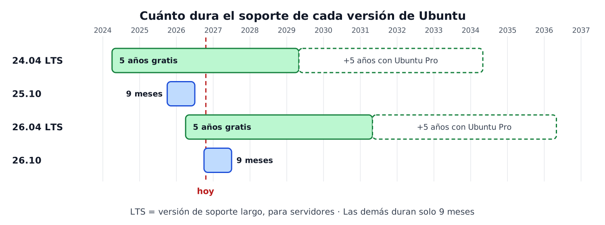
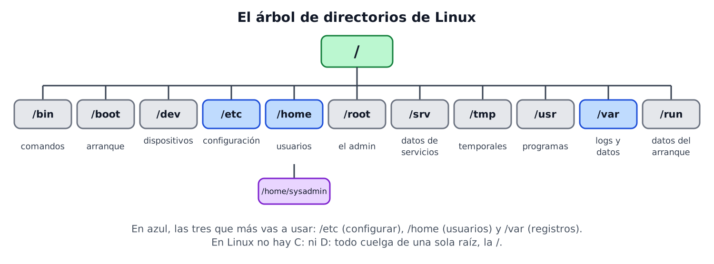

# Tema 6 — Sistemas operativos libres: instalación, administración y configuración (Ubuntu Server)


---

## Índice

1. [Introducción](#1-introducción)
2. [Linux, distribuciones y versiones de Ubuntu](#2-linux-distribuciones-y-versiones-de-ubuntu)
3. [Antes de instalar](#3-antes-de-instalar)
4. [Instalación paso a paso](#4-instalación-paso-a-paso)
5. [Discos y sistemas de archivos](#5-discos-y-sistemas-de-archivos)
6. [Después de instalar](#6-después-de-instalar)
7. [Comandos básicos](#7-comandos-básicos)
8. [Estructura de directorios y software instalado](#8-estructura-de-directorios-y-software-instalado)
9. [Información del sistema y rendimiento](#9-información-del-sistema-y-rendimiento)
10. [Automatizar instalaciones](#10-automatizar-instalaciones)

---

## 1. Introducción

En el Tema 5 instalamos y administramos **Windows**. Ahora hacemos lo mismo con **Linux**, y en concreto con **Ubuntu Server**, el sistema que usaremos en el resto del curso.

| Windows Server (Temas 2 a 5) | Ubuntu Server (este tema) |
|---|---|
| Se maneja con ventanas y ratón | **No tiene escritorio**: se maneja escribiendo comandos |
| Licencia de pago | Libre y gratuito |
| Se conecta por escritorio remoto (RDP) | Se conecta por **SSH** (texto) |

> Los bloques **"Pruébalo"** de este tema se hacen en tu propio Ubuntu Server, que instalas en la práctica.

---

## 2. Linux, distribuciones y versiones de Ubuntu

### 2.1. Qué es una distribución

**Linux** es el **núcleo** (*kernel*) del sistema. Una **distribución** es ese núcleo más un conjunto de programas, un instalador y un gestor de paquetes. Casi todas son software libre.

| Familia | Distribuciones de servidor | Gestor de paquetes |
|---|---|---|
| Debian | **Ubuntu Server**, Debian | `apt` |
| Red Hat | Red Hat Enterprise Linux, Rocky Linux, AlmaLinux | `dnf` |
| SUSE | SUSE Linux Enterprise, openSUSE | `zypper` |

Usamos **Ubuntu Server** porque es la más popular en servidores y en la nube, tiene mucha documentación, y comparte la forma de trabajar de toda la familia Debian.

### 2.2. Versiones de Ubuntu: LTS y no LTS

Ubuntu saca una versión **cada 6 meses**, en abril y en octubre. El número es el **año y el mes**: `26.04` es abril de 2026.

| Tipo | Cuándo sale | Soporte | Para qué |
|---|---|---|---|
| **LTS** (*Long Term Support*) | Cada 2 años, en abril | **5 años** de actualizaciones de seguridad gratis | **Servidores** y equipos que no se quieren tocar |
| No LTS (provisional) | Cada 6 meses | Solo **9 meses** | Probar novedades |



| Versión | Qué es hoy |
|---|---|
| **26.04 LTS** | La **LTS actual**: la que instalamos. Soporte estándar hasta 2031, y hasta 2036 con *Ubuntu Pro* |
| 26.10 | La última versión no LTS: dura solo 9 meses |
| 24.04 LTS | La LTS anterior, con soporte hasta 2029 |
| 22.04 LTS | Sigue con soporte hasta 2027 |

> Con **Ubuntu Pro** las actualizaciones de seguridad se alargan hasta **10 años** en una LTS. Fuente: [ubuntu.com/about/release-cycle](https://ubuntu.com/about/release-cycle).

Un **servidor** se instala una vez y se quiere dejar funcionando años: por eso en un servidor se elige siempre una **LTS**. Las versiones de **punto** (`26.04.1`, `26.04.2`...) son la misma LTS con las correcciones acumuladas, y la que se descarga ya es la última.

**Pruébalo:** ¿qué versión es la tuya?
1. Una vez instalado, ejecuta `cat /etc/os-release`.
2. Anota `VERSION` y busca si dice **LTS**.
3. ¿Hasta qué año tiene soporte estándar?

---

## 3. Antes de instalar

### 3.1. Server o Desktop

Ubuntu tiene dos ediciones principales:

| | Ubuntu **Server** | Ubuntu Desktop |
|---|---|---|
| Escritorio gráfico | **No** | Sí |
| Uso típico | Servidores, nube, máquinas que se administran de forma remota | Ordenadores personales |
| Recursos | Muy pocos | Bastantes más |
| Instalador | En modo texto, con menús | Gráfico |

Dentro de Server, el instalador ofrece **Ubuntu Server** (el normal) y **Ubuntu Server (minimized)**, una versión recortada pensada para contenedores y la nube. Nosotros usamos la normal.

### 3.2. Requisitos

| Requisito | Mínimo | Recomendado |
|---|---|---|
| Memoria RAM | 1,5 GB | 3 GB o más |
| Disco | 5 GB | 25 GB o más |
| Medio de instalación | USB o DVD (o una ISO en una VM) | |

> En nuestras VM usaremos **2 GB de RAM y 25 GB de disco**. Con la RAM que VirtualBox propone por defecto no llega al mínimo.

### 3.3. El soporte de instalación

La instalación empieza con una **imagen ISO**, que se descarga de [ubuntu.com/download/server](https://ubuntu.com/download/server). El nombre sigue este formato: `ubuntu-26.04.1-live-server-amd64.iso`.

| Dónde se instala | Cómo se usa la ISO |
|---|---|
| Una máquina virtual (lo que hacemos) | Se conecta a la VM como si fuera un DVD |
| Un equipo real | Se graba en un **USB de arranque** con una herramienta como **Rufus**, y se pone el USB como primer dispositivo de arranque en la BIOS/UEFI (como vimos en el Tema 5) |

---

## 4. Instalación paso a paso

El instalador de Ubuntu Server funciona en **modo texto**: se mueve con las **flechas**, se elige con **Intro** y se marcan casillas con **Espacio**. El ratón no sirve.

| Pantalla | Qué hacer en la práctica |
|---|---|
| 1. Idioma | **Español** |
| 2. Actualizar el instalador (solo si aparece) | Da igual: actualizar o continuar sin actualizar |
| 3. Teclado | **Spanish** y **Spanish** |
| 4. Tipo de instalación | **Ubuntu Server** (no la *minimized*) |
| 5. Red | Con red: déjala en **DHCP** y **anota la IP**. En la práctica de hoy **no habrá red** (cable desconectado): saldrá sin IP, y es normal |
| 6. Proxy | En blanco |
| 7. Mirror (servidor de descarga) | El que sale por defecto. Sin red avisará de que no puede conectar: **continúa** |
| 8. Almacenamiento | **Usar un disco completo** (*Use an entire disk*) con las opciones por defecto. Revisa el resumen y confirma |
| 9. Perfil | Tu nombre, nombre del servidor, usuario y contraseña (ver abajo) |
| 10. SSH | **Marca "Install OpenSSH server"** |
| 11. Snaps destacados | **No marques ninguno** (sin red ni se cargan) |
| 12. Instalación | Espera. Al terminar, **Reboot Now** |

| Campo del perfil | Qué poner |
|---|---|
| Nombre del servidor | `srv-` y tu nombre (por ejemplo `srv-marta`) |
| Usuario | `PCXXX` |
| Contraseña | una que cumpla 8 caracteres |

> **El instalador te confirma antes de borrar el disco.** En una VM no hay problema, porque el disco es virtual. En un equipo real, esa pantalla borra **todo** lo que haya en él.

> **Dos cosas que despistan:**
> - Al escribir una contraseña en el terminal **no se ve nada**, ni asteriscos. Está escribiendo igualmente.
> - Si el teclado está mal elegido, símbolos como `@` o `-` salen en otra tecla. Lo notarás en la contraseña.

El usuario que se crea aquí es **administrador**: puede usar `sudo`. Es el único con ese poder hasta que se creen más.

> **¿Y si instalo sin red?** Funciona, y es más rápido: el instalador no consulta el mirror ni descarga actualizaciones. Pero el sistema queda **sin actualizar** y **sin conexión** desde el primer arranque, así que lo primero será configurar la red y después actualizar. Al arrancar sin red puede tardar un par de minutos en llegar al *login*, esperando a la red.

---

## 5. Discos y sistemas de archivos

Durante la instalación se prepara el disco: se divide en **particiones** y cada una recibe un **sistema de archivos**. Basta con **una partición** para instalar Linux, aunque se pueden crear más.

| Sistema de archivos | Para qué se usa |
|---|---|
| **ext4** | El estándar en Linux. Archivos de hasta 16 TiB |
| xfs, btrfs | Alternativas para casos concretos |
| swap | Espacio de intercambio: hace de "RAM de emergencia" en el disco |
| FAT32 | Para la partición de arranque en equipos con UEFI y para pendrives |

En el almacenamiento, el instalador propone **LVM** (*Logical Volume Manager*): en vez de repartir el disco en particiones fijas, crea un **grupo de volúmenes** del que se sacan **volúmenes lógicos**. La ventaja es que más adelante se puede **ampliar** un volumen sin reinstalar nada.

> Si quieres otra distribución del disco, la opción *Custom storage layout* te deja crear las particiones a mano.

**Pruébalo:** mira tu disco.
1. `lsblk` muestra los discos, las particiones y los volúmenes.
2. `lsblk -f` añade el sistema de archivos de cada uno. ¿Cuál sale en tu volumen principal?
3. `df -h` muestra cuánto espacio libre queda en cada uno.

---

## 6. Después de instalar

Tras reiniciar, el servidor te pide **usuario y contraseña**, y te deja en una línea de comandos. Esto es lo primero que hace un administrador:

| Tarea | Comando | Equivalente en Windows |
|---|---|---|
| Actualizar la **lista** de paquetes | `sudo apt update` | Buscar actualizaciones |
| **Instalar** las actualizaciones | `sudo apt upgrade` | Instalar actualizaciones |
| Ver el nombre del equipo | `hostnamectl` | `hostname` |
| Ver la fecha y la zona horaria | `timedatectl` | Configuración → Hora |
| Ver la IP | `ip a` | `ipconfig` |
| Probar la conexión | `ping -c 4 8.8.8.8` | `ping 8.8.8.8` |
| Entrar desde otro equipo | `ssh usuario@IP` | Escritorio remoto (RDP) |

> `apt update` **no instala nada**: solo descarga la lista de lo que hay disponible. Lo que instala es `apt upgrade`. Y en Linux `ping` no se detiene solo: se pone `-c 4` para que mande 4 y pare (o `Ctrl + C`).

### 6.1. La red con Netplan

Ubuntu Server configura la red con **Netplan**: un archivo de texto `.yaml` dentro de `/etc/netplan/`.

| Paso | Comando |
|---|---|
| 1. Ver el nombre de la interfaz | `ip link` (en VirtualBox suele ser `enp0s3`) |
| 2. Ver qué archivo hay | `ls /etc/netplan/` |
| 3. Ver su contenido | `sudo cat /etc/netplan/archivo.yaml` (sin `sudo` da *Permission denied*: el archivo es solo del administrador) |
| 4. Editarlo | `sudo nano /etc/netplan/archivo.yaml` |
| 5. Aplicar el cambio sin reiniciar | `sudo netplan apply` |
| 6. Comprobar que hay IP | `ip a` |

Para pedir la IP por **DHCP** (es decir, que la dé el router), el archivo queda así:

```
network:
  version: 2
  ethernets:
    enp0s3:
      dhcp4: true
```

> **Cuidado con el formato:** la sangría se hace con **espacios** o **tabulaciones** y cada nivel tiene los suyos. Un espacio de más o de menos y Netplan da error. Cambia `enp0s3` por el nombre real de tu interfaz.

> **Puede que no haga falta cambiar nada:** el instalador suele dejar ya `dhcp4: true`. Si es así, basta con conectar el cable y ejecutar `sudo netplan apply`. Si Netplan avisa de que los **permisos son demasiado abiertos**, ejecuta `sudo chmod 600 archivo.yaml`.

La IP la reparte el router, así que **puede cambiar** al reiniciar. Para un servidor de verdad se fija una IP, pero eso es otra historia.

### 6.2. Administrar por SSH

Un servidor suele estar en una sala, sin pantalla. Se administra con **SSH**: una conexión **cifrada** por texto desde otro equipo.

| Paso | Qué hacer |
|---|---|
| 1 | Averiguar la IP del servidor (`ip a`) |
| 2 | Desde otro equipo, en `cmd` o PowerShell: `ssh sysadmin@IP` |
| 3 | La primera vez pregunta si te fías: escribe `yes` |
| 4 | Escribir la contraseña (no se ve) |
| 5 | Para salir: `exit` |

Para que el PC real y la VM se vean, la VM tiene que estar en **adaptador puente** (como en el Tema 3).

### 6.3. Hardware y controladores

En Linux **no existe un Administrador de dispositivos** con botones. Casi todos los controladores **vienen dentro del núcleo** y se cargan solos. Cuando falta alguno (en equipos reales, por ejemplo una tarjeta gráfica concreta), lo facilita el fabricante.

| Qué quieres ver | Comando |
|---|---|
| El procesador | `lscpu` |
| Los dispositivos PCI (tarjeta de red, gráfica...) | `lspci` |
| Los dispositivos USB | `lsusb` |
| Los discos | `lsblk` |
| La memoria | `free -h` |

**Pruébalo:** en tu Ubuntu Server ejecuta `ip a`, `hostnamectl` y `lscpu`. Anota la IP, el nombre del equipo y el número de procesadores.

---

## 7. Comandos básicos

Todo se hace con un **intérprete de comandos** (*shell*). Los comandos tienen una orden y, a veces, **opciones** (`-h`) y **argumentos** (el archivo o la carpeta sobre la que actúan).

**Moverse y ver:**

| Comando | Qué hace | En Windows |
|---|---|---|
| `pwd` | Dónde estoy | `cd` sin nada |
| `ls` / `ls -l` | Ver el contenido de una carpeta (`-l`: con detalles) | `dir` |
| `cd carpeta` | Entrar en una carpeta (`cd ..` sube, `cd /` va a la raíz) | `cd` |

**Archivos y carpetas:**

| Comando | Qué hace | En Windows |
|---|---|---|
| `mkdir carpeta` | Crea una carpeta | `mkdir` |
| `touch archivo` | Crea un archivo vacío | |
| `cp origen destino` | Copia | `copy` |
| `mv origen destino` | Mueve o renombra | `move` |
| `rm archivo` | Borra (**sin papelera**) | `del` |
| `cat archivo` | Muestra su contenido | `type` |
| `nano archivo` | Editor de texto sencillo (`Ctrl + O` guarda y `Ctrl + X` sale) | Bloc de notas |

**Sistema:**

| Comando | Qué hace |
|---|---|
| `sudo comando` | Ejecuta el comando **como administrador** |
| `date` | Fecha y hora |
| `who` | Quién está conectado |
| `df -h` / `free -h` | Espacio en disco / memoria |
| `history` | Los últimos comandos que has ejecutado |
| `alias nombre="comando"` | Crea un atajo para un comando (dura hasta cerrar la sesión) |
| `file archivo` | Dice de qué tipo es un archivo |
| `hostname` | Nombre del equipo |
| `exit` | Cierra la sesión |
| `sudo poweroff` / `sudo reboot` | Apaga / reinicia (también vale `sudo shutdown -h now`) |
| `man comando` o `comando --help` | La ayuda del comando |

**Paquetes:**

| Comando | Qué hace |
|---|---|
| `sudo apt update` | Actualiza la lista de paquetes |
| `sudo apt upgrade` | Instala las actualizaciones |
| `sudo apt install nombre` | Instala un programa |
| `sudo apt remove nombre` | Lo desinstala |

> **Trucos que ahorran mucho:** la tecla **Tab** completa los nombres, y la flecha **↑** recupera el comando anterior.

`sudo` pide **tu** contraseña, no la de otro usuario. Es la forma de usar poderes de administrador solo cuando hacen falta, en lugar de trabajar siempre como `root` (el superusuario, que lo puede todo).

> **En Ubuntu la cuenta `root` viene bloqueada:** no tiene contraseña, y por eso `passwd root` sin `sudo` te dice que no puedes. Con `sudo passwd root` se le pone una, y entonces `su -` te convierte en `root`. No se recomienda en un servidor real: un comando mal puesto como `root` no pregunta ni se puede deshacer. Se vuelve a bloquear con `sudo passwd -l root`.

**Pruébalo:**
1. `pwd` y `ls`. ¿En qué carpeta estás?
2. `mkdir prueba`, `cd prueba`, `touch hola.txt` y `ls`.
3. `nano hola.txt`: escribe una línea, `Ctrl + O`, Intro, `Ctrl + X`. Después `cat hola.txt`.
4. `cd ..` y `rm -r prueba` (el `-r` borra la carpeta con su contenido).

---

## 8. Estructura de directorios y software instalado

En Windows hay una letra por unidad (`C:`, `D:`). En Linux **no**: todo cuelga de una única carpeta raíz, `/`, y los discos se "montan" dentro de ella.



| Carpeta | Qué contiene | En Windows se parece a |
|---|---|---|
| `/etc` | Archivos de **configuración** del sistema | El Registro y `C:\ProgramData` |
| `/home` | Archivos de cada usuario (`/home/sysadmin`) | `C:\Users` |
| `/root` | Carpeta del usuario `root` | |
| `/var` | Datos que cambian: **registros** (`/var/log`), bases de datos | |
| `/usr` | Programas y librerías instalados | `C:\Program Files` |
| `/bin` y `/sbin` | Comandos básicos del sistema | `C:\Windows\System32` |
| `/boot` | Archivos para arrancar | |
| `/dev` | Los dispositivos, representados como archivos | |
| `/srv` | Datos de los servicios que ofrece el servidor | |
| `/tmp` | Archivos temporales | `%TEMP%` |
| `/run` | Datos que se crean en cada arranque | |

**El software instalado** se consulta con comandos:

| Qué | Comando |
|---|---|
| Paquetes instalados con `apt` | `apt list --installed` |
| Lo mismo, de otra forma | `dpkg -l` |
| Programas instalados con `snap` | `snap list` |
| ¿Está instalado un paquete? | `apt list --installed \| grep ssh` |

**Pruébalo:**
1. `ls /` y compáralo con la imagen. ¿Falta alguna carpeta?
2. `ls /etc | head` (el `| head` muestra solo las primeras líneas).
3. `ls /var/log` y `ls /home`.
4. `apt list --installed | grep openssh`. ¿Sale `openssh-server`?

---

## 9. Información del sistema y rendimiento

Linux guarda la información del sistema en archivos de texto de las carpetas `/etc` y `/proc`, y ofrece comandos para consultarla.

| Qué quieres saber | Comando |
|---|---|
| Versión de Ubuntu | `cat /etc/os-release` |
| Versión del núcleo | `uname -r` |
| Información del procesador | `cat /proc/cpuinfo` o `lscpu` |
| Información de la memoria | `cat /proc/meminfo` o `free -h` |
| Cuánto lleva encendido y la carga | `uptime` |
| Espacio en disco | `df -h` |

La carpeta **`/proc`** es especial: no está en el disco, es una "ventana" al sistema en tiempo real. Con `ls /proc` ves archivos como `cpuinfo`, `meminfo`, `version` o `mounts`.

**Rendimiento:**

| Comando | Qué muestra |
|---|---|
| `top` | Procesos en tiempo real, con CPU y memoria (sale con `q`) |
| `ps -ef` | Los procesos que hay ahora (`ps -ef \| grep ssh` filtra por nombre) |
| `uptime` | Tiempo encendido y **carga media** (1, 5 y 15 minutos) |
| `free -h` | Memoria usada y libre |
| `vmstat` | Memoria, intercambio y procesador |
| `mpstat`, `sar` | Estadísticas detalladas de CPU, memoria y red (se instalan con `sudo apt install sysstat`) |
| `tcpdump` | Captura el tráfico de red (para diagnosticar problemas) |

> Si la **carga media** de `uptime` es mayor que el número de procesadores, el equipo va justo.

**Pruébalo:**
1. `cat /etc/os-release`, `uname -r` y `uptime`.
2. `cat /proc/cpuinfo | head -20` y `cat /proc/meminfo | head -5`.
3. `free -h`. ¿Cuánta memoria total tiene? ¿Coincide con la que configuraste en la VM?
4. `top`. ¿Qué proceso usa más CPU? Sal con `q`.

---

## 10. Automatizar instalaciones

Instalar un servidor a mano está bien si es uno. Si son muchos, se automatiza. Hay dos caminos:

| Método | Cómo funciona | Cuándo |
|---|---|---|
| **Clonezilla** | Copia un disco o una partición a una **imagen** y la vuelca en otros equipos | Muchos equipos **iguales**, con todo ya instalado y configurado |
| **Autoinstall** | Ubuntu Server instala **sin preguntar**, leyendo un archivo de respuestas | Instalaciones repetibles desde cero |

Con **Clonezilla** se arranca desde su USB y se elige el modo según el origen y el destino:

| Opción | Qué hace |
|---|---|
| `disk_to_local_disk` | Copia un disco a otro disco del mismo equipo |
| `disk_to_remote_disk` | Copia el disco a otro equipo por la red |
| `part_to_local_part` | Copia una partición a otra partición local |
| `part_to_remote_part` | Copia una partición a otro equipo por la red |

> Clonezilla sobrescribe el disco de destino sin preguntar más. **Haz siempre una copia antes** y comprueba cuál es el origen y cuál el destino.

---

## Resumen del tema

| Tema | Lo que hay que saber hacer |
|---|---|
| Distribuciones | Distinguir núcleo, distribución y gestor de paquetes (`apt`, `dnf`, `zypper`) |
| Versiones | Explicar **LTS** frente a no LTS, y por qué un servidor lleva una LTS |
| Requisitos | Conocer los mínimos de Ubuntu Server y de dónde sale la ISO |
| Instalación | Seguir el instalador de Ubuntu Server y saber qué se elige en cada pantalla |
| Discos | Saber que basta una partición, qué es ext4 y para qué sirve LVM |
| Después de instalar | Configurar la red con **Netplan**, `apt update` y `apt upgrade`, `ip a`, `hostnamectl` y `ssh` |
| Comandos | `pwd`, `ls`, `cd`, `mkdir`, `cp`, `mv`, `rm`, `cat`, `nano`, `sudo`, `alias` e `history` |
| Directorios | Saber qué hay en `/etc`, `/home`, `/var` y `/usr`, y consultar el software instalado |
| Información del sistema | `cat /etc/os-release`, `uname -r`, `/proc`, `lscpu` y `free -h` |
| Rendimiento | `top`, `ps`, `uptime`, `free` y `vmstat` |
| Automatización | Reconocer Clonezilla y Autoinstall |


