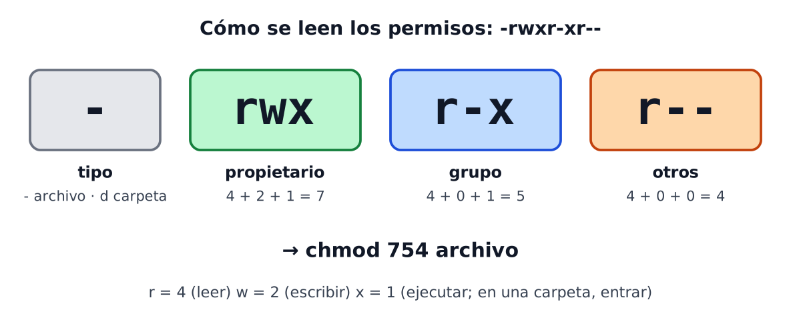

# Tema 7 — Administración de sistemas operativos libres (Ubuntu Server)

---

## Índice

1. [Introducción](#1-introducción)
2. [Línea de comandos](#2-arquitectura-unix-y-línea-de-comandos)
3. [Usuarios y grupos locales](#3-usuarios-y-grupos-locales)
4. [Usuarios y grupos predeterminados](#4-usuarios-y-grupos-predeterminados)
5. [Permisos](#5-permisos)
6. [sudo y permisos elevados](#6-sudo-y-permisos-elevados)
7. [Servicios y tareas programadas](#7-servicios-y-tareas-programadas)
8. [Registros](#8-registros)
9. [Almacenamiento](#9-almacenamiento)
10. [Copias de seguridad y mantenimiento](#10-copias-de-seguridad-y-mantenimiento)
11. [Para reconocer](#11-para-reconocer)

---

## 1. Introducción

En el Tema 6 instalaste Ubuntu Server. Ahora toca **administrarlo**: quién puede entrar, qué puede hacer cada uno, qué se ejecuta solo y cómo se protege la información.

| Tarea de un administrador | Dónde se ve en este tema |
|---|---|
| Crear y gestionar usuarios | Apartados 3 y 4 |
| Decidir quién accede a qué | Apartados 5 y 6 |
| Automatizar tareas y controlar servicios | Apartado 7 |
| Vigilar lo que pasa en el servidor | Apartado 8 |
| Proteger y copiar la información | Apartados 9 y 10 |

> Los bloques **"Pruébalo"** se hacen en tu Ubuntu Server del Tema 6.
>
> Los comandos básicos (`ls`, `cd`, `pwd`, `mkdir`...) ya los usaste en la práctica 6B.

---

## 2. Arquitectura UNIX y línea de comandos

Linux se basa en **UNIX**, un diseño de los años 70 que sigue vigente. Sus ideas principales:

| Característica | Qué significa |
|---|---|
| **Multiusuario y multitarea** | Varios usuarios y procesos a la vez |
| **Modular** | Muchas herramientas pequeñas que se combinan entre sí |
| **Sistema de archivos jerárquico** | Todo cuelga de una raíz, `/` |
| **Portabilidad** | Funciona en hardware muy distinto |

La **línea de comandos** es eficiente (sin menús), se puede **automatizar** con scripts, da **más control** y consume muy pocos recursos.

Como las herramientas son pequeñas, se **combinan**:

| Símbolo | Qué hace | Ejemplo |
|---|---|---|
| `\|` | Pasa la salida de un comando al siguiente | `ls /etc \| grep ssh` |
| `>` | Guarda la salida en un archivo (lo **sobrescribe**) | `date > fecha.txt` |
| `>>` | Añade la salida al final del archivo | `date >> fecha.txt` |
| `grep texto` | Filtra las líneas que contienen el texto | `cat /etc/passwd \| grep pcXXX` |
| `head` / `tail` | Muestra las primeras / últimas líneas | `tail -n 5 fecha.txt` |

**Pruébalo:**
1. `ls /etc | grep ssh`. ¿Qué sale?
2. `date >> fecha.txt` dos veces y `cat fecha.txt`. ¿Cuántas líneas hay?
3. `date > fecha.txt` y `cat fecha.txt`. ¿Qué ha cambiado y por qué?

---

## 3. Usuarios y grupos locales

Crear, modificar y borrar **usuarios** y **grupos** es una de las tareas básicas de un administrador. Linux guarda esa información en archivos de texto:

| Archivo | Qué contiene |
|---|---|
| `/etc/passwd` | La lista de usuarios (nombre, UID, carpeta personal, intérprete) |
| `/etc/group` | La lista de grupos y sus miembros |
| `/etc/shadow` | Las contraseñas **cifradas**. Solo lo lee `root` |

Cada usuario y cada grupo tiene un número: el **UID** y el **GID**. El superusuario `root` siempre tiene el UID **0**. Los usuarios normales empiezan en el 1000.

| Tarea | Comando |
|---|---|
| Crear un usuario | `sudo adduser pepito` |
| Cambiar su contraseña | `sudo passwd pepito` |
| Crear un grupo | `sudo groupadd amigos` |
| **Añadir** un usuario a un grupo | `sudo usermod -aG amigos pepito` |
| Cambiar el nombre de un grupo | `sudo groupmod -n vecinos amigos` |
| Ver los grupos de un usuario | `groups pepito` o `id pepito` |
| Borrar un usuario (y su carpeta) | `sudo userdel -r pepito` |
| Borrar un grupo | `sudo groupdel vecinos` |

> **`adduser` o `useradd`:** `adduser` es el cómodo de Debian y Ubuntu: pregunta la contraseña y crea la carpeta en `/home`. `useradd` es la herramienta básica de todas las distribuciones y **no** crea la carpeta si no se añade `-m`.
>
> **Cuidado con `-aG`:** `usermod -G` sin la `a` **reemplaza** todos los grupos del usuario. Con `-aG` los **añade** a los que ya tenía.

**Pruébalo:**
1. `sudo adduser pepito` (la contraseña no se ve; la información extra se puede dejar en blanco con Intro).
2. `id pepito` y `grep pepito /etc/passwd`. ¿Qué UID tiene? ¿Qué carpeta personal?
3. `ls /home`. ¿Aparece su carpeta?
4. `sudo userdel -r pepito` y vuelve a mirar `/home`.

---

## 4. Usuarios y grupos predeterminados

Además de los tuyos, el sistema trae usuarios y grupos que **ya existen** y que necesita para funcionar.

| Usuario | Para qué sirve |
|---|---|
| `root` | El **superusuario**: lo puede todo. Hay que usarlo con cuidado |
| `daemon` | Lo usan servicios que se ejecutan en segundo plano |
| `sys` | Tareas del sistema |
| `www-data` | El usuario con el que corre un servidor web |
| `nobody` | Un usuario sin permisos, para procesos que no necesitan ninguno |

La mayoría tienen como intérprete `/usr/sbin/nologin`: nadie puede **iniciar sesión** con ellos. Son **cuentas de servicio**.

| Grupo | Para qué sirve |
|---|---|
| `sudo` | Sus miembros pueden usar `sudo` (en Ubuntu) |
| `wheel` | Lo mismo en Red Hat y derivados: **no existe en Ubuntu** |
| `adm` | Pueden leer los registros del sistema |

> En Ubuntu, cada usuario tiene además **su propio grupo**, con su mismo nombre.

**Pruébalo:**
1. `grep -E "^(sudo|adm):" /etc/group`. ¿Está `pcXXX` en ellos?
2. `grep nologin /etc/passwd | head -5`. ¿Qué usuarios no pueden iniciar sesión?

---

## 5. Permisos

Cada archivo y cada carpeta tiene un **propietario**, un **grupo** y tres tipos de permisos para tres tipos de personas.



| Letra | Permiso | Valor | En una carpeta |
|---|---|---|---|
| `r` | Leer | 4 | Ver lo que contiene |
| `w` | Escribir | 2 | Crear y borrar archivos |
| `x` | Ejecutar | 1 | **Entrar** en ella |

Se ven con `ls -l`:

```
-rw-r--r-- 1 pcXXX pcXXX 120 oct 21 10:00 notas.txt
drwxrwx--- 2 root     equipo   4096 oct 21 10:05 compartida
```

| Comando | Qué hace | Ejemplo |
|---|---|---|
| `chmod` | Cambia los **permisos** | `chmod 640 notas.txt` o `chmod g+w notas.txt` |
| `chown` | Cambia el **propietario** (y el grupo) | `sudo chown ana:equipo notas.txt` |
| `chgrp` | Cambia el **grupo** | `sudo chgrp equipo notas.txt` |

| Número | Quién puede hacer qué | Uso típico |
|---|---|---|
| `600` | Solo el propietario lee y escribe | Archivos privados |
| `644` | Propietario lee y escribe; el resto, solo lee | Archivos normales |
| `700` | Solo el propietario | Carpetas personales |
| `755` | Todos entran y leen; solo el propietario escribe | Carpetas y programas públicos |
| `770` | Propietario y grupo, todo; los demás, nada | Carpetas de un equipo |
| `2770` | Como 770, y lo que se cree dentro **hereda el grupo** de la carpeta | Carpetas **compartidas** de un grupo |

> El `2` inicial de `2770` activa el bit **setgid**: los archivos nuevos que se crean en esa carpeta pertenecen al grupo de la carpeta, y no al grupo personal de quien los crea. Es lo que hace falta para una carpeta compartida.

**Pruébalo:**
1. `touch prueba.txt` y `ls -l prueba.txt`. ¿Qué permisos tiene?
2. `chmod 600 prueba.txt` y `ls -l prueba.txt`. ¿Qué ha cambiado?
3. `chmod g+w,o+r prueba.txt` y mira otra vez. ¿Qué hace cada parte?

---

## 6. sudo y permisos elevados

Trabajar siempre como `root` es peligroso: un error lo borra todo. En Ubuntu el usuario `root` **no tiene contraseña** para entrar, y los administradores usan **`sudo`**.

| Cosa | Cómo funciona |
|---|---|
| `sudo comando` | Ejecuta **solo ese comando** como administrador, pidiendo **tu** contraseña |
| Grupo `sudo` | Quien está en él, puede usar `sudo` |
| `/etc/sudoers` | Define quién puede ejecutar qué con `sudo`. Se edita **solo** con `sudo visudo`, que comprueba la sintaxis antes de guardar |
| Registro | Cada uso de `sudo` queda **anotado**: se sabe quién ejecutó qué y cuándo |

Buenas prácticas de seguridad:

| Práctica | Por qué |
|---|---|
| **Mínimos privilegios** | Dar solo los permisos necesarios. Carpetas personales `700` y públicas `755` |
| Dar `sudo` solo a quien lo necesite | Menos riesgo de acceso no autorizado |
| **Usar grupos** para dar permisos | Es más fácil de revisar que dar permisos a cada persona |
| Revisar los permisos de vez en cuando | Se quedan obsoletos |
| Evitar `sudo` en scripts automáticos | Reduce riesgos |
| Mirar los registros de `sudo` | Para detectar usos extraños |

**Pruébalo:**
1. `sudo -l` muestra lo que puedes hacer con `sudo`.
2. `id`. ¿Está `sudo` entre tus grupos?
3. **No edites** `/etc/sudoers` a mano: si lo haces con un editor normal y te equivocas, pierdes `sudo`. Se usa `sudo visudo`.

---

## 7. Servicios y tareas programadas

Un **servicio** es un programa que se ejecuta **en segundo plano** (SSH, un servidor web...). En Ubuntu los gestiona **systemd**, con `systemctl`:

| Comando | Qué hace |
|---|---|
| `systemctl status nombre` | Ver si está en marcha |
| `sudo systemctl start nombre` | Arrancarlo |
| `sudo systemctl stop nombre` | Pararlo |
| `sudo systemctl restart nombre` | Reiniciarlo |
| `sudo systemctl enable nombre` | Que arranque **solo** con el sistema |
| `systemctl list-units --type=service` | Ver los servicios |

Cada servicio debería correr con su **propia cuenta de servicio**, con los permisos mínimos. Si lo atacan, el daño se queda en esa cuenta.

La **automatización** evita errores humanos y ahorra tiempo. Hay dos herramientas:

| Herramienta | Qué es |
|---|---|
| **cron** | Ejecuta tareas a horas fijas. Se configura con `crontab -e` |
| **Temporizadores de systemd** | La alternativa moderna: más flexible y con más control |

Cada línea de cron tiene **cinco campos de tiempo** y después el comando:

```
*  *  *  *  *   comando
│  │  │  │  └─ día de la semana (0-7, el 0 y el 7 son domingo)
│  │  │  └──── mes (1-12)
│  │  └─────── día del mes (1-31)
│  └────────── hora (0-23)
└───────────── minuto (0-59)
```

| Línea | Cuándo se ejecuta |
|---|---|
| `* * * * * comando` | Cada minuto |
| `30 2 * * * comando` | Todos los días a las 2:30 |
| `0 9 * * 1 comando` | Los lunes a las 9:00 |
| `*/15 * * * * comando` | Cada 15 minutos |

| Comando | Qué hace |
|---|---|
| `crontab -e` | Edita tus tareas (la primera vez pide elegir editor: `nano`) |
| `crontab -l` | Muestra tus tareas |
| `crontab -r` | **Borra todas** tus tareas |

**Pruébalo:**
1. `systemctl status cron`. ¿Está activo?
2. `systemctl list-units --type=service | head -15`.
3. `systemctl status ssh`. Si pone `inactive` y aun así te conectas bien por SSH, es normal en algunas versiones: Ubuntu arranca SSH solo cuando alguien se conecta (mira `ssh.socket`).

---

## 8. Registros

Un servidor **anota** lo que ocurre. Revisar esas notas sirve para saber **quién hizo qué** y detectar cosas sospechosas.

| Qué quieres saber | Cómo |
|---|---|
| Los últimos accesos al equipo | `last -n 10` |
| Quién está conectado ahora | `who` |
| Los mensajes del sistema | `sudo journalctl -n 20` |
| Los mensajes de un servicio | `sudo journalctl -u ssh` |
| Quién usó `sudo` | `sudo journalctl \| grep sudo \| tail` |
| Archivos de registro | La carpeta `/var/log` |

> **Monitorizar** es mirar los registros **a tiempo**, no solo después de un problema.

**Pruébalo:**
1. `last -n 5`. ¿Aparece tu sesión SSH del Tema 6?
2. `sudo journalctl --no-pager | grep sudo | tail -n 5`. ¿Ves los comandos que has ejecutado con `sudo`?

---

## 9. Almacenamiento

| Qué quieres hacer | Comando |
|---|---|
| Ver discos y particiones | `lsblk` |
| Ver el espacio libre | `df -h` |
| Ver cuánto ocupa una carpeta | `du -sh /var/log` |

> **`fdisk` también modifica** las particiones. Para **mirar**, usa `lsblk`. Crear o borrar particiones destruye datos.

El disco se puede **cifrar** con **LUKS**: sin la contraseña, el contenido es ilegible. Si se **pierde la clave, se pierden los datos**, así que hay que guardar una copia en un sitio seguro.

**Pruébalo:** `lsblk`, `df -h` y `du -sh /var/log`. ¿Qué ocupa más: `/var/log` o `/home`?

---

## 10. Copias de seguridad y mantenimiento

### 10.1. Copias de seguridad

Las copias protegen frente a fallos, errores y ataques. Dos herramientas básicas:

| Herramienta | Qué hace | Ejemplo |
|---|---|---|
| **rsync** | Copia carpetas **solo con lo que ha cambiado**, en local o por SSH | `rsync -av origen/ destino/` |
| **tar** | Empaqueta y comprime una carpeta en **un archivo** | `tar -czf copia.tar.gz carpeta/` |

Y para ver el contenido de un `.tar.gz` sin descomprimirlo: `tar -tzf copia.tar.gz`. **rsnapshot** automatiza copias con `rsync` y se configura en `/etc/rsnapshot.conf` (solo para reconocer).

| Tipo de copia | Qué guarda | Ventaja | Inconveniente |
|---|---|---|---|
| **Completa** | Todo | La más fácil de restaurar | Ocupa mucho y tarda |
| **Incremental** | Lo cambiado desde la **última copia** (de cualquier tipo) | Muy rápida y pequeña | Restaurar necesita la cadena entera |
| **Diferencial** | Lo cambiado desde la **última completa** | Restaurar necesita solo 2 copias | Crece cada día |

> Una copia que **no se ha probado a restaurar**, no es una copia. Y una copia en el mismo disco que los datos, tampoco.

### 10.2. Actualizar y mantener

El gestor de paquetes depende de la distribución:

| Distribución | Gestor | Actualizar la lista | Instalar actualizaciones |
|---|---|---|---|
| Ubuntu, Debian | `apt` | `sudo apt update` | `sudo apt upgrade` |
| Fedora, Red Hat y derivados | `dnf` | `sudo dnf check-update` | `sudo dnf upgrade` |
| SUSE | `zypper` | `sudo zypper refresh` | `sudo zypper update` |

Para mantener un Ubuntu Server al día:

| Paso | Comando | Para qué |
|---|---|---|
| 1 | `sudo apt update` | Actualiza la lista de paquetes |
| 2 | `sudo apt upgrade` | Instala las actualizaciones |
| 3 | `sudo apt full-upgrade` | Actualización más completa: puede instalar o quitar paquetes si hace falta |
| 4 | `sudo apt autoremove` | Quita lo que ya no se necesita |
| 5 | Reiniciar si lo pide | Se sabe si existe `/var/run/reboot-required` |
| 6 | **Documentar** lo hecho | Para que quien venga después sepa qué pasó |

> `apt full-upgrade` es el equivalente moderno de `apt-get dist-upgrade`, que verás en muchos manuales. Ubuntu Server normalmente ya instala **solas** las actualizaciones de seguridad (servicio `unattended-upgrades`).

**Pruébalo:**
1. `apt list --upgradable` lista lo que está pendiente de actualizar.
2. `ls /var/run/reboot-required`. Si sale *No such file*, no hace falta reiniciar.
3. `sudo apt autoremove` (te dirá qué va a quitar y pedirá confirmación).

---

## 11. Para reconocer

Estas herramientas existen y conviene saber **para qué sirven**. No las vamos a usar en las prácticas.

| Herramienta | Para qué sirve |
|---|---|
| **ACL** (`getfacl`, `setfacl -m u:ana:rw archivo`) | Dar permisos a **una persona concreta** sin cambiar propietario ni grupo |
| **auditd**, `ausearch`, `aureport` | Auditoría detallada: registra, busca y resume eventos de seguridad |
| **LUKS**, **eCryptfs** | Cifrar un disco o una carpeta personal |
| **Cuotas de disco** | Limitar el espacio que ocupa cada usuario |
| **Políticas de contraseñas** (`sudo chage -l usuario`) | Longitud, complejidad y caducidad |
| **Ansible**, **Puppet** | Configurar **muchos servidores** a la vez |
| **TLP**, **powertop** | Ahorrar batería en **portátiles** |
| **Unison** | Sincronizar carpetas en los dos sentidos (`rsync` solo en uno) |
| **rsnapshot**, **Deja Dup** | Copias de seguridad automáticas |

---

## Resumen del tema

| Tema | Lo que hay que saber hacer |
|---|---|
| Comandos | Combinar comandos con `\|`, `>` y `grep` |
| Usuarios y grupos | `adduser`, `passwd`, `groupadd`, `usermod -aG`, `userdel -r` y `id` |
| Predeterminados | Reconocer `root`, las cuentas de servicio y el grupo `sudo` |
| Permisos | Leer `ls -l` y usar `chmod`, `chown` y el `2770` de una carpeta compartida |
| sudo | Por qué se usa en vez de `root`, y que `sudoers` se edita con `visudo` |
| Servicios y cron | `systemctl status` y escribir una línea de `crontab` |
| Registros | `last`, `journalctl` y `/var/log` |
| Almacenamiento | `lsblk`, `df` y qué es LUKS |
| Copias y actualización | `rsync`, `tar`, tipos de copia, y `apt update` y `apt upgrade` |

---

## Recursos

- 🧩 [Práctica: administrar Ubuntu Server](practica-administracion.md)
- 📝 [Casos prácticos del tema](casospracticos.md)
- 🎬 [Vídeo: "Introducción a los comandos de Linux"](https://bit.ly/30IbFHL)
- 🎧 [Audio: "Derechos en Ubuntu"](https://bit.ly/2AM793v)

---

**Siguiente paso:** [Casos prácticos del Tema 7 →](casospracticos.md)

