# Tema 8 — Gestión de varios sistemas operativos en un ordenador

---

## Índice

1. [Introducción](#1-introducción)
2. [Los gestores de arranque](#2-los-gestores-de-arranque)
3. [Ficheros de inicio](#3-ficheros-de-inicio-de-los-sistemas-operativos)
4. [Tablas de particiones y particiones](#4-tablas-de-particiones-y-particiones)
5. [Particiones en Windows](#5-particiones-en-windows)
6. [Particiones en Linux](#6-particiones-en-linux)
7. [Instalar varios sistemas operativos en un equipo](#7-instalar-varios-sistemas-operativos-en-un-equipo)
8. [Gestión avanzada de discos y archivos](#8-gestión-avanzada-de-discos-y-archivos)
9. [Para reconocer](#9-para-reconocer)

---

## 1. Introducción

Un ordenador puede tener **más de un sistema operativo** (por ejemplo Windows y Ubuntu). En este tema vemos lo que hay **debajo**: cómo arranca el equipo y cómo se organiza el disco.

| Apartado | Qué se ve |
|---|---|
| 2 | Los gestores de arranque |
| 3 | Ficheros de inicio de los sistemas operativos |
| 4 | Tablas de particiones y particiones |
| 5 | Particiones en Windows |
| 6 | Particiones en Linux: crear, formatear y montar |
| 7 | Instalar varios sistemas operativos en un equipo |
| 8 | Gestión avanzada de discos y archivos |
| 9 | Para reconocer |

---

## 2. Los gestores de arranque

### Qué pasa al encender el ordenador


| Paso | Qué hace |
|---|---|
| **BIOS / UEFI** | Es el programa de la placa base. Carga el código de arranque maestro |
| **Código de arranque maestro (MBR)** | Programa pequeño en el **primer sector (sector 0)** del disco. Busca y carga el gestor de arranque |
| **Gestor de arranque** | Inicia el sistema operativo. Si hay **varios**, te deja **elegir** |

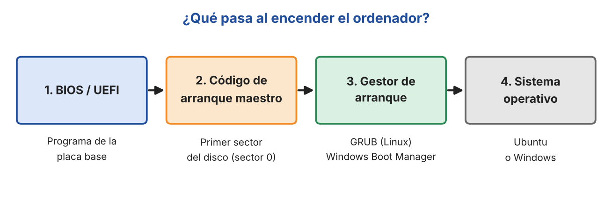

### Gestor de arranque en cada sistema

| Sistema | Gestor | 
|---|---|---|
| **Linux** | **GRUB** (el más usado; Ubuntu y Linux Mint). Otro: **LILO** (hoy casi no se usa) | 
| **Windows** | **Windows Boot Manager** (archivo `winload.exe`) | 

> Los dos gestores se instalan solos durante la instalación del sistema

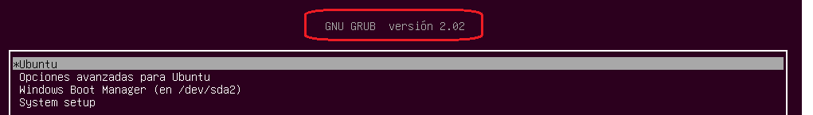

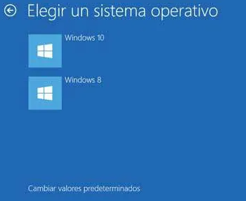

### Reglas para que convivan

| Situación | Regla |
|---|---|
| Windows **y** Linux | Instala **Windows primero** y **Linux el último**: así GRUB detecta todos los sistemas y los añade a su lista |
| Varias versiones de Windows | Instala primero la **más antigua** y después la más reciente |
| Has instalado otro sistema después | Desde Linux: `sudo update-grub2` actualiza la lista del menú |

> En Ubuntu el comando se llama `update-grub` y también existe como `update-grub2`. Es el mismo.


### Reparar el gestor de arranque de Windows

El gestor se puede **dañar** por una actualización, un *malware*, un cambio en el sistema o un problema en el **MBR**. Entonces Windows no arranca.

| Opción | Cómo |
|---|---|
| **Gráfica** | Arrancar con un dispositivo externo con la **ISO de Windows** → **Reparar** → **Reparación de inicio** |
| **Línea de comandos** | Misma ISO → **Reparar** → **Símbolo del sistema** y escribir los comandos de la tabla |

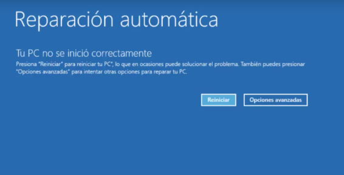

 

| Comando | Para qué sirve |
|---|---|
| `bootrec /fixmbr` | Repara el registro maestro de arranque (MBR) |
| `bootrec /fixboot` | Escribe un sector de arranque nuevo |
| `bootrec /rebuildbcd` | Busca los Windows instalados y reconstruye el BCD |

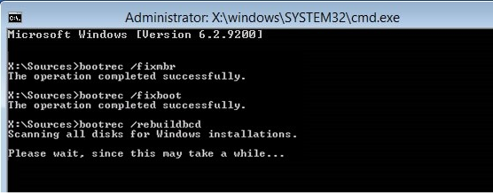

> Consejo: elige un gestor de arranque **compatible con todos los sistemas** que vas a instalar.

---

## 3. Ficheros de inicio de los sistemas operativos

Son archivos que se ejecutan **solos al arrancar**. Preparan el entorno **antes** de que el usuario use el sistema.

| Sistema | Fichero | Para qué sirve |
|---|---|---|
| **Windows** | `boot.ini` | Opciones de arranque (versiones **antiguas**) |
| | **BCD** (*Boot Configuration Data*) | Sustituye a `boot.ini` en versiones **modernas** |
| | `AUTOEXEC.BAT` y `CONFIG.SYS` | Entorno y dispositivos en DOS y Windows **antiguos** |
| **Linux** | `/etc/fstab` | Sistemas de archivos que se **montan al inicio** |
| | `/etc/init.d/` | *Scripts* de inicio de los servicios |
| | **GRUB** → `/boot/grub/grub.cfg` | Configuración del gestor de arranque |

**Pruébalo (Ubuntu Server):**
1. `cat /etc/fstab`. ¿Qué sistemas de archivos se montan al inicio?
2. `sudo grep menuentry /boot/grub/grub.cfg | head -5`. ¿Qué entradas de menú tiene GRUB?

> `grub.cfg` **no se edita a mano**: lo genera `update-grub`.

---

## 4. Tablas de particiones y particiones

Una **partición** es una **parte** de un disco que se trata como si fuera un disco aparte. Sirve para **separar el sistema de los datos** y para **instalar varios sistemas** en el mismo disco.

La **tabla de particiones** es la lista que dice dónde empieza y termina cada partición. Hay dos tipos:

| | **MBR** | **GPT** |
|---|---|---|
| Antigüedad | Tradicional (años 80) | Moderno, **sustituye** a MBR |
| Particiones | Máximo **4 primarias** | Hasta **128** |
| Tamaño de disco | Hasta **2 TB** | Prácticamente **ilimitado** (9,4 ZB) |
| Arranque | BIOS | Placa con **UEFI** |
| Seguridad | Una sola copia de la tabla | **Copia de seguridad** de la tabla al final del disco |

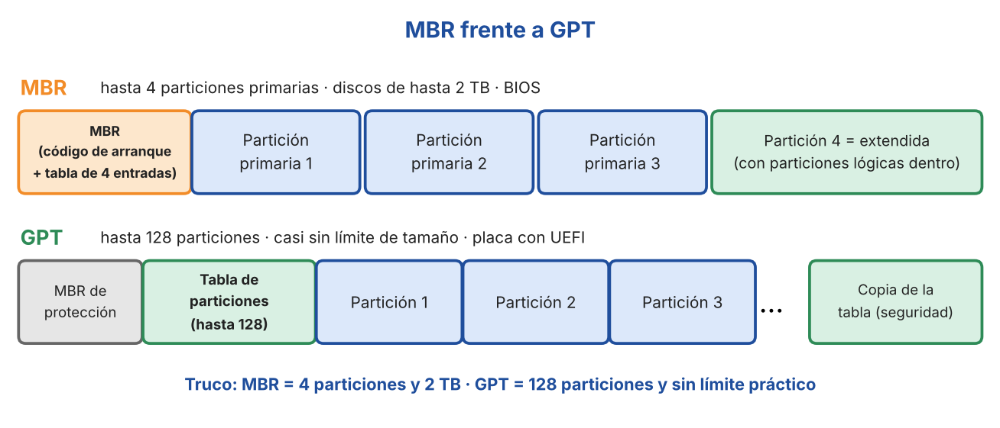

> **Truco para recordar:** MBR = **4** particiones y **2** TB. GPT = **128** particiones y sin límite práctico.

### Sistemas de archivos habituales

| Sistema | Dónde se usa |
|---|---|
| **NTFS** | Windows |
| **ext4** | Ubuntu y Linux |
| **FAT32** | Partición de arranque en equipos con UEFI y pendrives |
| **ExFAT** | Pendrives y discos externos que se usan en **varios sistemas** (Windows y Linux) |

### Espacio mínimo para instalar

| Sistema | Espacio en disco |
|---|---|
| **Ubuntu** | Mínimo **9 GB**; se recomiendan unos **25 GB** |
| **Windows 10 (64 bits)** | Al menos **32 GB** libres |

---

## 5. Particiones en Windows

### Ver el tipo de tabla (MBR o GPT)

1. **Administración de equipos** (en *Herramientas administrativas*).
2. **Almacenamiento** → **Administrador de discos**.
3. Clic derecho sobre el **disco** (no sobre una partición) → **Propiedades**.
4. Pestaña **Volúmenes** → campo **Estilo de partición**.

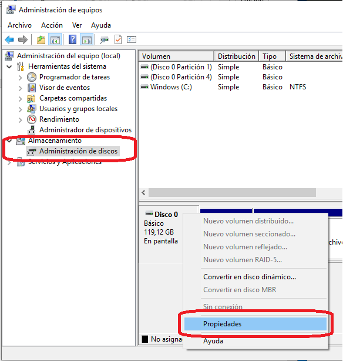

### Crear una partición nueva

1. En el Administrador de discos, clic derecho sobre la partición que vas a **reducir** → **Reducir volumen**.
2. Indica **cuánto** reducir. Ese será el espacio para el nuevo sistema.
3. Aparece un espacio **No asignado** (en negro): todavía **no tiene formato**.
4. El formato (NTFS en Windows, ext4 en Ubuntu) se asigna **durante la instalación** del nuevo sistema.

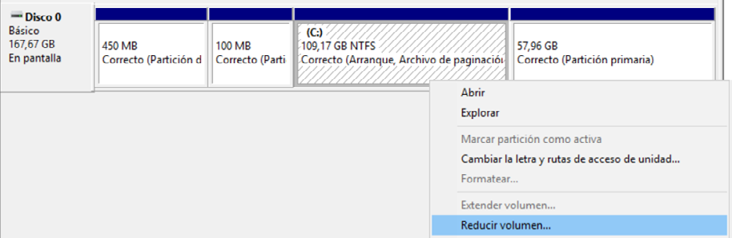

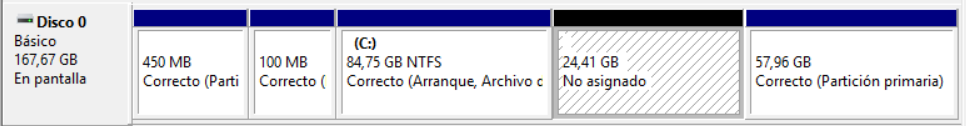

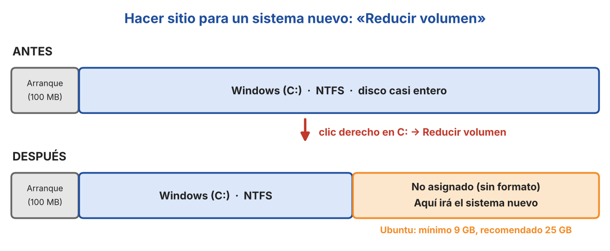

**Pruébalo (Windows Server):**
1. Abre el Administrador de discos. ¿Qué particiones ves y qué tamaño tiene cada una?
2. Mira el **Estilo de partición** de tu disco: ¿MBR o GPT?
3. Clic derecho en `D:` → **Reducir volumen**. Mira el espacio que permite reducir y pulsa **Cancelar** (no lo reduzcas).

---

## 6. Particiones en Linux

### Tipos de particiones

| Tipo | Qué es |
|---|---|
| **Primarias** | En MBR, hasta **4** (o 3 primarias + 1 extendida) |
| **Extendida** | Una primaria que **contiene** otras particiones |
| **Lógicas** | Viven **dentro** de la extendida y permiten pasar del límite de 4 |
| **GPT** | Moderno: hasta **128** por defecto y discos grandes |

### Herramientas

| Herramienta | Qué es |
|---|---|
| `fdisk` | Línea de comandos. Crea, borra y modifica particiones en discos **MBR** |
| `parted` | Más avanzada: **MBR y GPT**, y permite **redimensionar** sin perder datos |
| `gparted` | Interfaz **gráfica** de `parted` |
| **Discos** | Herramienta gráfica de Ubuntu Desktop (en *Utilidades*): montar, formatear, imágenes y prueba de rendimiento |

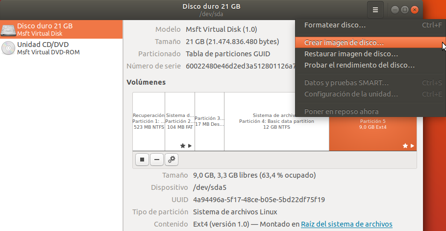

### Ver los discos ➕

| Comando | Qué muestra |
|---|---|
| `lsblk` | Discos y particiones en forma de árbol (`sda`, `sda1`...) |
| `sudo fdisk -l /dev/sda` | Detalle del disco, incluido el **tipo de tabla** (*Disklabel type*: `dos` = MBR, `gpt` = GPT) |
| `df -h` | Particiones **montadas** y espacio libre |

> Los nombres: el primer disco es `sda`, el segundo `sdb`... y sus particiones `sda1`, `sda2`, `sdb1`...

### Crear una partición con `fdisk` ➕

`sudo fdisk /dev/sdb` abre un menú. Se escribe una letra y Intro:

| Tecla | Qué hace |
|---|---|
| `n` | **N**ueva partición (acepta lo que propone con Intro: tipo `p`, número 1, todo el disco) |
| `p` | **P**rint: muestra la lista de particiones, para comprobar |
| `w` | **W**rite: **guarda** los cambios y sale |
| `q` | **Q**uit: sale **sin guardar** |

> **Hasta que no pulsas `w`, no se ha cambiado nada.** Si te equivocas, `q`.
>
> **¡Cuidado con el disco!** Comprueba con `lsblk` que es el nuevo y no el del sistema.

### Dar formato ➕

Una partición nueva no tiene sistema de archivos. Se le da con:

```
sudo mkfs.ext4 /dev/sdb1
```

> `mkfs.ext4` **borra** lo que hubiera en la partición.

### Montaje y desmontaje

**Montar** es hacer accesible una partición dentro del árbol de carpetas. Se monta **en una carpeta**.

| Comando | Qué hace |
|---|---|
| `sudo mount /dev/sdb1 /mnt/datos` | Monta la partición en la carpeta `/mnt/datos` (la carpeta debe existir) |
| `sudo umount /mnt/datos` | La desmonta (no hay `n` en `umount`) |
| `sudo mount -a` ➕ | Monta todo lo que dice `/etc/fstab` |

> ➕ `rmdir carpeta` borra una carpeta **vacía** (por ejemplo, el punto de montaje cuando ya no lo necesitas).
>
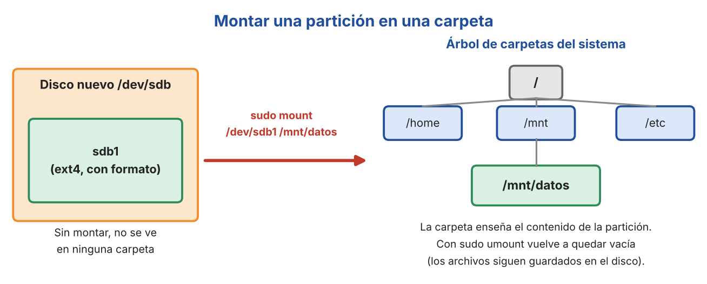

> Si `umount` dice **target is busy**, estás dentro de esa carpeta o la usa un programa: sal con `cd`.

### Montaje permanente: `/etc/fstab`

`mount` solo vale **hasta reiniciar**. Para que se monte **en cada arranque**, se añade una línea a `/etc/fstab` (se edita con `sudo nano`) ➕:

```
/dev/sdb1   /mnt/datos   ext4   defaults,nofail   0   2
```

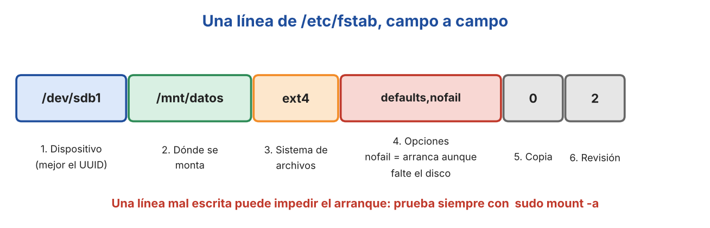

| Campo | Significado en el ejemplo |
|---|---|
| 1. Dispositivo | `/dev/sdb1` (en la vida real se usa el **UUID**, que se ve con `lsblk -f`) |
| 2. Dónde se monta | `/mnt/datos` |
| 3. Sistema de archivos | `ext4` |
| 4. Opciones | `defaults` = normal. `nofail` = si el disco no está, **el sistema arranca igual** |
| 5. y 6. | `0 2` (copia y comprobación: déjalos así) |

> Una línea **mal escrita** en `fstab` puede impedir que el sistema arranque. Por eso se prueba con `sudo mount -a` **antes de reiniciar**.

**Pruébalo (Ubuntu Server):**
1. `lsblk`. ¿Qué discos y particiones hay?
2. `sudo fdisk -l /dev/sda`. ¿Qué tipo de tabla tiene (*Disklabel type*)?
3. `df -h`. ¿Qué está montado y dónde?

---

## 7. Instalar varios sistemas operativos en un equipo

En las máquinas virtuales de este curso cada sistema vive **aislado**, pero en un equipo **real** pueden convivir varios en el mismo disco. Este apartado **no se practica**: sirve para entender cómo se hace.

### Windows y Linux

| Paso | Qué hacer |
|---|---|
| 1 | Tener **Windows instalado** y **espacio libre** (reducir volumen) |
| 2 | Descargar la **ISO** de la distribución Linux y pasarla a un **dispositivo externo** (USB). **Rufus** lo hace y deja elegir **MBR o GPT** según el equipo |
| 3 | Configurar la **BIOS** para que arranque desde el USB |
| 4 | En el asistente de Ubuntu elegir **Instalar Ubuntu junto a Windows Boot Manager** |
| 5 | Ajustar el **tamaño de cada partición** y seguir el asistente de siempre |
| 6 | Al encender, **GRUB** deja elegir entre Ubuntu y Windows |

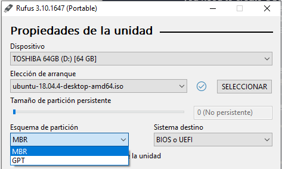

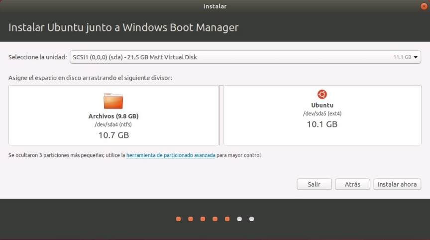

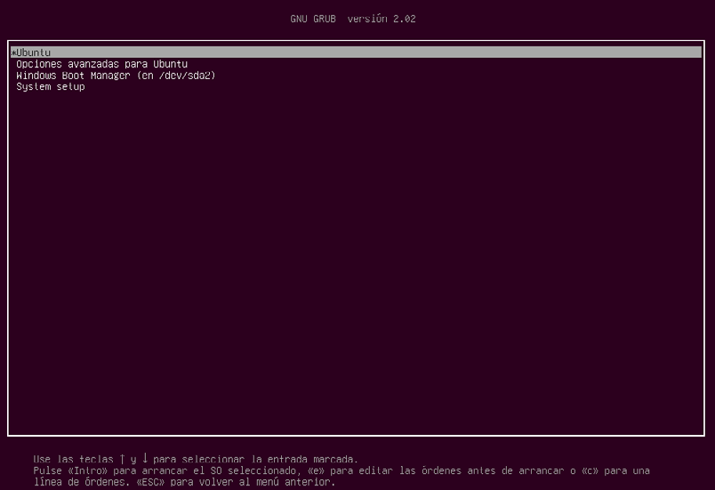

---

## 8. Gestión avanzada de discos y archivos

### Automatización

Los *scripts* ahorran tiempo y **errores humanos**. Se usan para copias de seguridad, limpieza de discos y mantenimiento.

| Sistema | Tipo de script |
|---|---|
| Linux | *Shell* (`.sh`) |
| Windows | *Batch* (`.bat`) |

### Desfragmentación y revisión

**Desfragmentar** es reorganizar los datos del disco para que se lean más rápido. Es útil en discos duros (**HDD**) y **menos necesario en SSD**.

| Sistema | Desfragmentar | Revisar y reparar |
|---|---|---|
| **Windows** | **Desfragmentador de disco** | `CHKDSK` |
| **Linux** | `e4defrag` (solo ext4) | `fsck` |

> `chkdsk D:` **solo comprueba**. Para reparar se añade `/f`. En Linux, `fsck` se ejecuta sobre una partición **desmontada**.

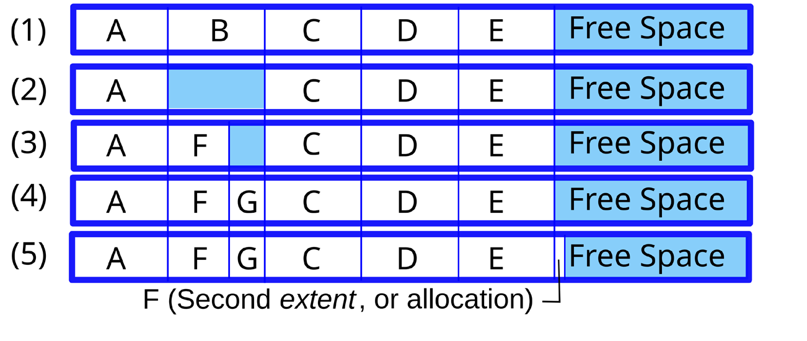

### Cambiar rutas a otra partición o a un recurso de red

Mover carpetas (Documentos, Imágenes...) a **otra partición** libera espacio en la unidad principal y ordena.

| Sistema | Cómo |
|---|---|
| **Windows** | Propiedades de la carpeta → pestaña **Ubicación**, o comandos de **PowerShell** |
| **Linux** | **Enlace simbólico**: `ln -s destino enlace` |

```
ln -s /mnt/datos /home/pcXXX/datos
```

Crea un **acceso directo**: lo que guardes en `/home/pcXXX/datos` se guarda realmente en `/mnt/datos`. `ls -l` lo muestra con una flecha: `datos -> /mnt/datos`.

> Con `ln -s` el **destino va primero** y el **nombre del enlace después**.

**Pruébalo (Ubuntu Server):** lo harás en la práctica con el disco nuevo.

---

## 9. Para reconocer

Estas herramientas existen y conviene saber **para qué sirven**. No las usaremos en las prácticas.

| Herramienta | Para qué sirve |
|---|---|
| **LILO** | Gestor de arranque antiguo de Linux, anterior a GRUB |
| `parted` y **gparted** | Gestionar particiones, también en GPT y con interfaz gráfica |
| `e4defrag` | Desfragmentar particiones ext4 |
| `fsck` | Revisar el sistema de archivos en Linux |

---

## Resumen del tema

| Tema | Lo que hay que saber hacer |
|---|---|
| Arranque | Explicar el orden BIOS/UEFI → código de arranque → gestor → sistema |
| Gestores | GRUB (Linux) y Windows Boot Manager |
| Reparar | `bootrec /fixmbr`, `/fixboot` y `/rebuildbcd`; `update-grub2` para GRUB |
| Ficheros de inicio | `BCD`, `/etc/fstab` y `/boot/grub/grub.cfg` |
| Tablas | MBR (4 particiones, 2 TB) frente a GPT (128, sin límite) |
| Windows | Administración de discos y **Reducir volumen** |
| Linux | `lsblk`, `fdisk`, `mkfs.ext4`, `mount`, `umount` y `/etc/fstab` |
| Varios sistemas | Windows primero y Linux al final; Rufus |
| Mantenimiento | `CHKDSK`, `fsck`, `e4defrag` y `ln -s` |


